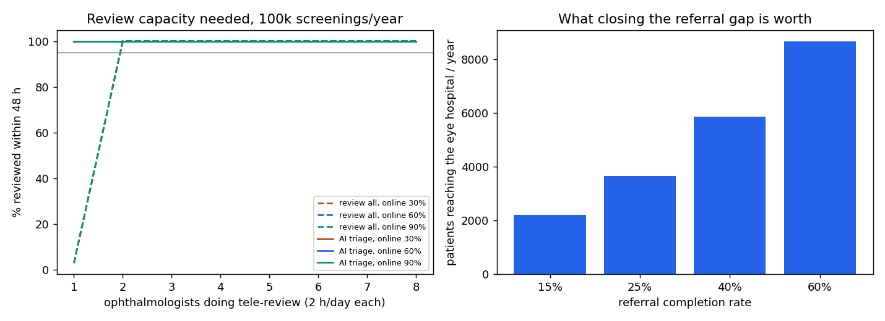

# DrishtiTrust validation report

Every figure below is generated from `results/*.json` by `scripts/make_report.py`.
95% intervals: Wilson for proportions, bootstrap (by exam where known) for AUC.
Thresholds were fitted on the calibration split (valB) only and frozen before any external image was scored.

## 1. Referable-DR grading (PS target: sensitivity > 90%, specificity > 85%)

Operating point λ_op = 0.3590 (chosen on valB for ≥95% sensitivity). Triage: auto-recall below λ_low = 0.2622 (CRC, target ≤3% of referable auto-recalled), direct referral at or above λ_high = 0.8488. Prediction sets target 90% coverage.

| Test set | Images | AUC | Sensitivity | Specificity | QWK | ECE | Meets PS target |
|---|---|---|---|---|---|---|---|
| valB (calibration, for reference) | 1505 | 0.983 (0.978–0.988) | 95.2% (93.2–96.5) | 92.4% (90.4–94.0) | 0.932 | 0.028 | yes |
| DDR test (internal) | 2503 | 0.989 (0.986–0.992) | 95.1% (93.7–96.2) | 93.7% (92.3–94.9) | 0.932 | 0.021 | yes |
| APTOS test (internal) | 534 | 0.987 (0.981–0.993) | 96.7% (93.4–98.4) | 91.0% (87.3–93.6) | 0.943 | 0.029 | yes |
| ODIR (held-out, China, mixed cameras) | 6228 | 0.946 (0.937–0.954) | 94.0% (92.5–95.3) | 75.4% (74.2–76.5) | 0.563 | 0.177 | no |
| IDRiD all 516 (external, India, Kowa) | 516 | 0.964 (0.950–0.976) | 92.9% (89.5–95.2) | 79.8% (73.6–84.9) | 0.825 | 0.047 | no |
| Messidor-2 (external, France, Topcon) | 1744 | 0.967 (0.957–0.976) | 91.7% (88.8–93.9) | 86.0% (84.0–87.8) | 0.708 | 0.090 | point estimate only |

### Messidor-2 at exam level, IDx-DR definition (moderate NPDR or worse and/or macular oedema)

874 exams, 270 referable. Published reference: IDx-DR X2.1, sensitivity 96.8%, specificity 87.0% (Abramoff et al., IOVS 2016).

| Configuration | Sensitivity | Specificity |
|---|---|---|
| CNN only | 93.7% (90.1–96.0) | 80.1% (76.8–83.1) |
| CNN + DME rule (exudate within 1 DD of fovea) | 94.1% (90.6–96.3) | 73.2% (69.5–76.6) |

## 2. Uncertainty: prediction sets and triage

| Test set | Set coverage | Mean set size | Recall | Review | Refer | Referable auto-recalled |
|---|---|---|---|---|---|---|
| valB (calibration, for reference) | 97.2% (96.2–97.9) | 2.12 | 51.6% | 11.8% | 36.6% | 18/660 (2.7% (1.7–4.3)) |
| DDR test (internal) | 97.0% (96.3–97.6) | 2.09 | 51.8% | 11.3% | 36.9% | 41/1119 (3.7% (2.7–4.9)) |
| APTOS test (internal) | 98.5% (97.1–99.2) | 2.27 | 53.6% | 16.5% | 30.0% | 2/213 (0.9% (0.3–3.4)) |
| ODIR (held-out, China, mixed cameras) | 90.4% (89.7–91.1) | 2.45 | 55.9% | 26.8% | 17.3% | 47/1110 (4.2% (3.2–5.6)) |
| IDRiD all 516 (external, India, Kowa) | 97.7% (96.0–98.7) | 2.80 | 29.6% | 29.1% | 41.3% | 13/323 (4.0% (2.4–6.8)) |
| Messidor-2 (external, France, Topcon) | 89.6% (88.1–91.0) | 2.22 | 60.5% | 18.3% | 21.2% | 26/457 (5.7% (3.9–8.2)) |

Per-grade coverage (external sets), showing where the guarantee is weakest:

- IDRiD all 516 (external, India, Kowa): grade 0: 99% (n=168), grade 1: 100% (n=25), grade 2: 98% (n=168), grade 3: 98% (n=93), grade 4: 94% (n=62)
- Messidor-2 (external, France, Topcon): grade 0: 85% (n=1017), grade 1: 99% (n=270), grade 2: 97% (n=347), grade 3: 95% (n=75), grade 4: 63% (n=35)

### Camera shift: re-calibrating λ_low from audit labels on the new camera

Target: at most 3% of referable eyes auto-recalled. Averages over 300 random audit orders.

| Deployment | Audit labels | Referable auto-recalled (mean / 90th pct) | Share auto-recalled | Operating point sensitivity (mean / 10th pct) | Specificity (mean / 10th pct) |
|---|---|---|---|---|---|
| IDRiD all 516 (external, India, Kowa) | none (frozen valB thresholds) | 4.0% / 4.0% | 29.6% | 92.9% / 92.9% | 79.8% / 79.8% |
| IDRiD all 516 (external, India, Kowa) | 50 | 0.9% / 3.5% | 8.6% | 96.8% / 92.5% | 59.4% / 19.3% |
| IDRiD all 516 (external, India, Kowa) | 100 | 1.8% / 4.5% | 20.8% | 95.4% / 91.2% | 70.3% / 56.4% |
| IDRiD all 516 (external, India, Kowa) | 200 | 2.4% / 5.0% | 24.2% | 95.3% / 91.5% | 71.7% / 63.8% |
| IDRiD all 516 (external, India, Kowa) | 300 | 2.8% / 5.3% | 25.0% | 95.1% / 91.7% | 72.5% / 66.7% |

With 200 audit labels and both thresholds re-fitted: healthy eyes referred directly 1.3%, referable eyes auto-recalled 2.3%, healthy eyes sent to tele-review 38.0%.
| Messidor-2 (external, France, Topcon) | none (frozen valB thresholds) | 5.7% / 5.7% | 60.5% | 91.7% / 91.7% | 86.0% / 86.0% |
| Messidor-2 (external, France, Topcon) | 50 | 0.0% / 0.0% | 0.0% | 91.8% / 91.4% | 85.8% / 85.8% |
| Messidor-2 (external, France, Topcon) | 100 | 0.2% / 0.0% | 3.8% | 96.1% / 91.5% | 70.0% / 52.9% |
| Messidor-2 (external, France, Topcon) | 200 | 2.1% / 4.8% | 46.2% | 95.8% / 92.0% | 73.3% / 64.2% |
| Messidor-2 (external, France, Topcon) | 300 | 2.5% / 5.2% | 50.3% | 95.6% / 92.0% | 74.6% / 66.0% |

With 200 audit labels and both thresholds re-fitted: healthy eyes referred directly 1.6%, referable eyes auto-recalled 2.1%, healthy eyes sent to tele-review 35.6%.
## 4. Lesion segmentation (pixel AUPR inside the field of view)

| Test set | MA | HE | EX | SE | Mean of 4 | OD | Published mean AUPR, same test set [1] |
|---|---|---|---|---|---|---|---|
| idrid_test (27 images) | 0.442 | 0.537 | 0.832 | 0.556 | **0.592** | 0.950 | IDRiD 2018 winners VRT 0.647, iFLYTEK 0.648; M2MRF 0.672 |
| ddr_test (225 images) | 0.173 | 0.429 | 0.527 | 0.389 | **0.379** | – | HRNetV2 0.452; M2MRF 0.499 |

_pixel AUPR inside the FOV at LESION_SIZE scale; IDRiD challenge scored at native resolution. [1] Liu et al., M2MRF, arXiv 2111.00193, Tables 4 and 6. Our lesion model is below the state of the art._

Lesion counts and overlays only include components whose peak confidence gives at least 75% precision on DDR-valid masks (kept / all predicted: MA 1477/2723, HE 656/1450, EX 1149/2128, SE 193/456).

Image-level lesion presence, idrid_test: MA sens 100% (88–100), spec n/a; HE sens 93% (77–98), spec n/a; EX sens 100% (88–100), spec n/a; SE sens 79% (52–92), spec 62% (36–82)
Image-level lesion presence, ddr_test: MA sens 93% (87–96), spec 15% (9–23); HE sens 95% (91–97), spec 45% (29–62); EX sens 99% (97–100), spec 41% (29–54); SE sens 74% (59–85), spec 74% (67–80)

## 5. Optic disc and fovea localisation (IDRiD test, original pixels)

Optic disc: mean distance 13.3 px (median 9.4); within 100 px: 99.0%. Fovea: mean 32.4 px (median 23.8); within 100 px: 94.2%, within 200 px: 100.0%.

## 6. Vessel segmentation

HRF test (images 11-15 of healthy / DR / glaucoma, 15 total), FOV diameter 1440px: sensitivity 79.5%, specificity 98.0%, accuracy 96.2%, AUC 0.980 (inside the FOV).

## 8. Image-quality gate

DDR test, detecting ungradable images: AUC 0.993; sensitivity 97.9% (95.1–99.1), specificity 96.9% (96.1–97.5).
Messidor-2 (external), adjudicated ungradable: AUC 0.872; sensitivity 25.0% (4.6–69.9), specificity 100.0% (99.8–100.0).

## 9a. District scenarios (100,000 screenings / year, 8% referable prevalence)

Triage rates are the measured conditional rates re-mixed to a screening population's prevalence; other parameters are in sim/params.yaml.

| Scenario | Recall | Tele-review | Direct refer | Direct referrals truly referable | Referable auto-recalled | Reviews / yr | Referrals / yr | Reach hospital / yr |
|---|---|---|---|---|---|---|---|---|
| calibrated camera (completion 15%) | 69.5% | 22.8% | 7.7% | 83% | 1.9% | 22,814 | 14,719 | 2,211 |
| calibrated camera (completion 40%) | 69.5% | 22.8% | 7.7% | 83% | 1.9% | 22,814 | 14,719 | 5,875 |
| new camera, frozen thresholds (completion 15%) | 56.5% | 32.2% | 11.2% | 53% | 3.7% | 31,103 | 18,236 | 2,756 |
| new camera, frozen thresholds (completion 40%) | 56.5% | 32.2% | 11.2% | 53% | 3.7% | 31,103 | 18,236 | 7,322 |
| new camera, recalibrated (200 audit labels) (completion 15%) | 27.5% | 66.8% | 5.7% | 79% | 2.3% | 62,414 | 14,253 | 2,103 |
| new camera, recalibrated (200 audit labels) (completion 40%) | 27.5% | 66.8% | 5.7% | 79% | 2.3% | 62,414 | 14,253 | 5,692 |

## 9b. District capacity sweep (100,000 screenings / year)

Triage fractions: eval_b0_final.json: DDR test (internal) [triage_cnn_only], re-mixed to prevalence 0.08.

Fewest tele-reviewers (2 h/day each) that review 95% of cases within 48 h:

- all images reviewed | online 0.3: 2
- all images reviewed | online 0.6: 2
- all images reviewed | online 0.9: 2
- AI triage | online 0.3: 1
- AI triage | online 0.6: 1
- AI triage | online 0.9: 1

Referral completion vs patients reaching the eye hospital per year:

- completion 15%: 2,211 patients/year (of 14,719 referred)
- completion 25%: 3,669 patients/year (of 14,719 referred)
- completion 40%: 5,875 patients/year (of 14,719 referred)
- completion 60%: 8,664 patients/year (of 14,719 referred)

## 10. Development history and disclosures

- **DDR's official split is confounded** (docs/DATASETS.md): every timestamp-series image in its train and valid sets is grade 0. A first grader trained on it reached validation AUC 0.987 but about 0.92 within either series. All results here use our series x grade stratified re-split.
- **IDRiD was looked at during development**: two grader runs (the confounded-split model and this one) were scored on it, and the lesion confidence problem was found on it. The fixes were then calibrated on development data only (DDR valid for lesion confidence, valB for the triage policy).
- **Every look at IDRiD and Messidor-2 is logged** in the register at the end of docs/EXPERIMENTS.md. Candidate models were ranked on ODIR, held out whole for that purpose; each final candidate was committed to in writing before being scored on the sealed sets, and scored once. No threshold, hyper-parameter or design choice was made after seeing them.
- **Training data**: DDR train + APTOS train + EyePACS (35,126, training only). ODIR is the model-selection set; Messidor-2, IDRiD and (if downloaded) mBRSET are never trained or tuned on.
- **The lesion rule engine is not a triage trigger** (configs/triage.json): at matched workload it added no safety over the CNN's own review band.
